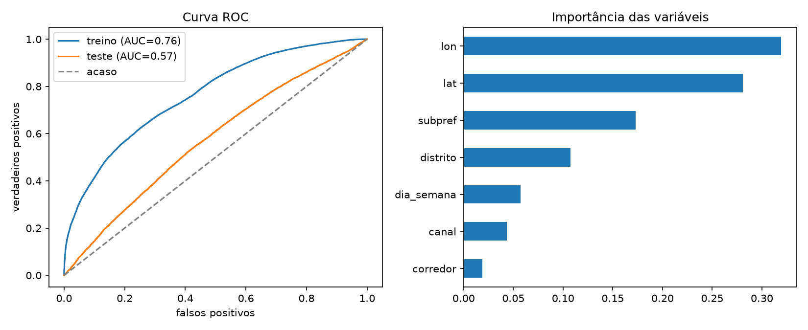

# Relatório de IA & Machine Learning · Zeladoria do Bairro

**GS CitizenTech 2026.2 · FIAP · Engenharia de Software (3º ano Fev)**

**Integrantes:** 
Augusto Rocha Silva - RM556316
Erik Yuuta Goto - RM558076
Guilherme Vieira Augusto - RM557264
Wendell dos Santos Silva - RM558859

**Vídeo (até 5 min):** https://youtu.be/9uRK2AbNikg

## 1. Problema e dados reais

A Zeladoria do Bairro permite que o morador registre um problema do espaço público e acompanhe o atendimento. A parte de ML responde a uma pergunta que importa para quem registra o chamado:

> **Dado um chamado de tapa-buraco aberto na cidade de São Paulo (canal, local e dia da semana), ele será resolvido em até 7 dias?**

É uma classificação binária (`resolvido_7d` = 1 ou 0). O limite de 7 dias deixa as duas classes equilibradas (49% de "sim" no treino).

**Dados:** SP156, os chamados reais da central 156 da Prefeitura de São Paulo, no Portal de Dados Abertos (https://dados.prefeitura.sp.gov.br/dataset/dados-do-sp156, licença CCZero). Usamos 5 trimestres, de 2024 T4 a 2025 T4, e 136.501 chamados de tapa-buraco após a limpeza. Fonte, arquivos, período e filtros estão em `dados/README.md`. Não há dado simulado, e endereço, número e CEP não são usados.

**Escolhas sobre os dados.** O plano da solução previa buraco, lixo e iluminação, mas iluminação não existe como serviço no SP156. Entulho e limpeza de bueiros existem, mas fecham em até 7 dias em 85% a 100% dos casos, o que tornaria a pergunta trivial. Ficamos com o tapa-buraco, que varia de verdade (mediana de 5 a 11 dias entre os trimestres usados). Dos 10 trimestres avaliados, descartamos os que têm muitos chamados ainda abertos (2024 T3 e 2026) ou o serviço em outro patamar (2024 T1).

## 2. Escolha do modelo

Usamos **Random Forest**:
- lida bem com variáveis mistas (categorias codificadas e números) e captura relações não lineares, como a combinação de região e localização, sem exigir normalização;
- é robusto a ruído e a variáveis pouco informativas, o que importa com poucas variáveis e dados reais;
- tem poucos hiperparâmetros sensíveis e treina rápido, o que permitiu validação cruzada em minutos;
- fornece a importância das variáveis, necessária para explicar o resultado ao cidadão.

O XGBoost, da mesma família, fica como melhoria futura. Como referência, usamos o **baseline** "sempre prever a classe mais comum".

## 3. Preparação e divisão treino/teste

**Limpeza.** Dos 137.299 chamados de tapa-buraco, removemos 588 cancelados, 187 "Finalizada" sem data de finalização (não dá para calcular o prazo) e 23 com coordenadas fora do município (erro de geocodificação). Chamados ainda abertos entram com rótulo 0, pois não foram resolvidos em 7 dias.

**Variáveis (7):** canal, prefeitura operacional (subprefeitura), distrito, dia da semana, se é em corredor de ônibus, latitude e longitude. `Status` e `Data de Finalização` só montam o alvo; usá-los como entrada seria vazamento de dados. O mês também não entra, porque treino e teste cobrem meses diferentes.

**Divisão por tempo, não aleatória.** O treino usa 2024 T4, 2025 T1 e 2025 T2 (86.710 linhas); o teste usa 2025 T3 e T4 (49.791 linhas). O mesmo buraco costuma gerar chamados quase idênticos, e numa divisão aleatória um iria para o treino e seu "gêmeo" para o teste, inflando a métrica. Separar por período simula o uso real: prever chamados de um período que o modelo não viu. O codificador de categorias é ajustado só no treino.

## 4. Treino com diferentes parâmetros

Busca em grade com **12 combinações de 3 hiperparâmetros**: número de árvores (100 ou 200), profundidade máxima (6, 12 ou 20) e mínimo de amostras por folha (5 ou 20). A **validação cruzada usa só o treino**, com um fold por trimestre, então cada rodada valida num trimestre que o modelo não viu. O critério é a AUC.

| Parâmetros (árvores / profundidade / folha) | AUC treino (folds) | AUC validação |
|---|---|---|
| 200 / 12 / 5 (**escolhido**) | 0,778 | **0,665** |
| 200 / 20 / 20 | 0,787 | 0,662 |
| 200 / 20 / 5 | 0,887 | 0,657 |
| 200 / 6 / 5 | 0,685 | 0,651 |

Árvores mais profundas e folhas pequenas aumentam a AUC no treino (0,887) sem ganho na validação, o que caracteriza overfitting. A profundidade 12 equilibra os dois lados (gráfico em `saida/figuras/2_busca_hiperparametros.png`). Os valores 100 e 200 árvores dão resultados quase idênticos.

## 5. Resultados em treino e teste

| Conjunto | Acurácia | Precisão | Revocação | F1 | AUC |
|---|---|---|---|---|---|
| Treino | 0,679 | 0,666 | 0,700 | 0,683 | 0,763 |
| Teste | 0,564 | 0,664 | 0,596 | 0,628 | 0,573 |

- **Overfitting moderado:** a AUC cai de 0,763 (treino) para 0,665 (validação cruzada) e 0,573 (teste). Pelo gráfico ROC, a curva do teste fica pouco acima da diagonal do acaso.
- **O serviço mudou entre os períodos.** A proporção de chamados resolvidos em 7 dias sobe de 49% no treino para 62% no teste, e a mediana cai de 11 para 5 dias (`saida/figuras/1_taxa_por_trimestre.png`). Interpretamos que o modelo, treinado numa fila mais lenta, subestima a rapidez no teste. Isso explica a baixa acurácia (0,564), mas não foi testado de forma isolada.
- **A acurácia sozinha engana:** prever sempre "sim" daria 0,617 no teste, mais que o modelo. Por isso a AUC é a métrica principal. A precisão de 0,664 é só um pouco acima da taxa real de resolvidos (0,617).
- **Variáveis:** localização domina (`lon` 0,32, `lat` 0,28, subprefeitura 0,17, distrito 0,11). Dia da semana (0,06), canal (0,04) e corredor (0,02) pesam pouco.
- **Tentativa que não melhorou:** acrescentar a demanda recente (chamados dos 7 dias anteriores no distrito e na cidade) deu AUC de teste de 0,567 (com as variáveis originais) e 0,549 (sem coordenadas), contra 0,571 do conjunto original, e piorou a validação cruzada. Mantivemos o conjunto original.

## 6. Conclusão e leitura para o cidadão

**O modelo aprende algo, mas pouco.** Com poucas variáveis e um serviço que mudou entre os períodos, ele não é confiável para dizer se **um chamado específico** será resolvido em 7 dias, e não deve ser usado para prometer prazo a um morador.

**Onde ele ajuda:** a ordem entre as regiões. Por subprefeitura (com pelo menos 300 chamados no teste), a probabilidade média prevista e a taxa real de resolução têm correlação de Spearman de **0,78** (`saida/figuras/4_subprefeituras.png`). Jabaquara (81% resolvidos em 7 dias), Jaçanã-Tremembé (79%) e Casa Verde-Cachoeirinha (73%) estão entre as mais rápidas; Pirituba-Jaraguá (48%), Lapa (49%) e Cidade Tiradentes (52%) entre as mais lentas. Mas o modelo subestima o nível em quase todas as regiões, e em algumas erra bastante (Itaim Paulista: previsto 25%, real 60%). Por isso, na Zeladoria do Bairro, o uso adequado é mostrar **"nesta região os buracos tendem a demorar mais ou menos"**, e não uma probabilidade por chamado. Isso ajuda o morador a calibrar a expectativa e o agente a identificar regiões que merecem reforço.

**Limitações:** só 7 variáveis (não sabemos o tamanho do buraco, a chuva ou a fila da equipe); o status dos chamados pode estar desatualizado; chamados repetidos do mesmo buraco; e os trimestres de 2026 não puderam ser usados por terem muitos chamados em aberto. **Próximos passos:** acrescentar dados de chuva (INMET) e tipo de via, e acompanhar o tempo de resolução ao longo do tempo para retreinar o modelo.

**ODS conectados:** ODS 11 (cidades e comunidades sustentáveis), porque melhora a transparência e a participação do morador no cuidado do espaço público; e ODS 9 (indústria, inovação e infraestrutura), porque usa dados para apoiar a manutenção da infraestrutura urbana.
